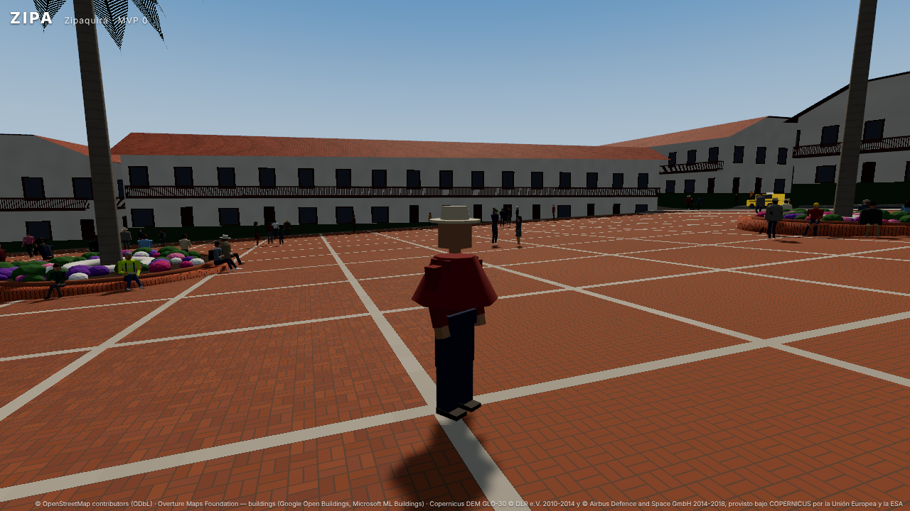
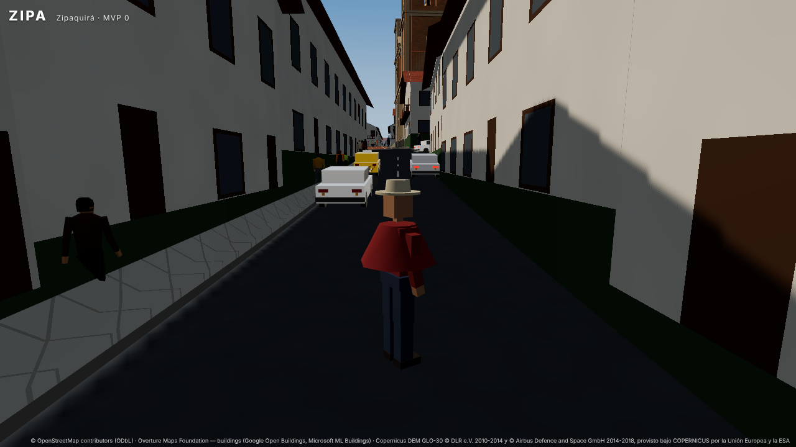

# Informe — Fase 1: vida (peatones, tráfico con vida, sonido de la ciudad)

No hay datos reales de peatones, paraderos, aforos ni parqueo en el área: todo lo de esta fase es **procedural y
plausible (ESTIMADO)**, determinista para una semilla y ajustable en `src/data/peatones.json` y
`src/data/trafico.json` (cada bloque trae su `_doc`).

## 1. Peatones

| Elemento | Cómo se hace | Certeza |
|---|---|---|
| **Red peatonal** (`src/peds/nav.ts`) | Andenes: ejes desplazados de cada vía con andén, recortados a los triángulos caminables de la malla `sidewalk` de `roads.glb` (los edificios cortan andenes). Senderos de OSM por su eje. Plaza y parque: rejilla de puntos sin materas, monumento ni fuente, más los puestos de las bancas. ~8 800 nodos | **derivada de datos** |
| **Cruces** | Las cebras del grafo vial, cruces de esquina estimados en cada acceso de los cruces de calles, senderos que atraviesan una calle y, a mitad de cuadra, sólo donde unen trozos de red aislados. Son las únicas aristas que pisan la calzada | **estimado** |
| **Población** | 220 peatones en una burbuja de 130 m alrededor del jugador; ~40 % buscan la plaza y ~14 % el parque cuando están en la burbuja. Aparecen y se van sólo donde el jugador no ve (la misma prueba de visibilidad del tráfico) | **estimado** |
| **Comportamiento** | Caminan en grupos de 2–3 (en fila india en andenes angostos), se sientan en las bancas circulares de las materas y en el borde de la fuente, conversan en corrillos, se quedan mirando, pasean, "entran a un local" donde no se ven. Esquivan al jugador y entre ellos | **estimado** |
| **Semáforos y brechas** | En un cruce semaforizado sólo se empieza a cruzar con el rojo de la vía cruzada y tiempo para llegar al otro lado (el rojo se mide observándolo); al pisar la calzada se vuelve a mirar y, si la gente lo demoró, se espera el siguiente rojo. Sin semáforo se espera una brecha entre vehículos (con paciencia agotada, se cruza corriendo). Quien cruza detiene al tráfico | **regla** |
| **Peligros** | Una moto (o vehículo) que se les viene encima los hace correr; si los alcanza, caen, se levantan y salen corriendo | **regla** |
| **Dibujo** (`src/peds/render.ts`) | Un solo `InstancedMesh` low-poly (200–500 triángulos) animado en el vertex shader con el estado de la simulación: marcha cuya fase avanza con la distancia recorrida (el pie de apoyo no patina), sentado, de pie con gestos, esperando, corriendo, en el suelo. Aspecto variado y determinista (estatura, complexión, ropa, sombrero, ruana, mochila) | — |

## 2. Tráfico con vida

- **Motos que filtran** (`traffic.filtering`): si el de adelante va lento y cerca, la moto se corre de lado (junto al
  sardinel, entre carriles del mismo sentido o por la línea central, sin tocar una buseta del carril contrario) y
  adelanta la fila. Vuelve al eje antes del cruce, nunca entra al cruce en rojo y queda adelante de los carros en el
  pare.
- **Busetas** (`traffic.busStops`): 39 paraderos procedimentales en el carril derecho de vías secundarias,
  terciarias y residenciales, lejos de cruces y cebras. La buseta se orilla con direccional derecha, se detiene
  6–15 s con luces de parqueo y vuelve al carril; quien viene detrás espera (las motos la pasan).
- **Luces**: freno (frenando o detenido), direccionales antes de cada giro y del lado del giro (mandan sobre la
  maniobra lateral), luces de parqueo, farola siempre encendida en las motos (obligatorio en Colombia). Parpadean con
  el reloj de la simulación, así que se congelan en la pausa.
- **Calles de un carril con parqueo** (`traffic.parking`): el pipeline estima 2 carriles para las calles residenciales
  de un sentido de 6,5 m; en el juego circulan por un solo carril junto al sardinel derecho, como en Zipaquirá, con el
  otro lado para parquear.
- **Vehículos parqueados** (`traffic.parked`, `src/traffic/parked.ts`): ~670 carros, taxis, camionetas y grupos de
  motos en diagonal (rueda trasera hacia el sardinel, inclinadas sobre el gato), en fila junto al sardinel y en el
  sentido del tráfico, lejos de cruces, cebras, cruces peatonales, paraderos y del puesto de la moto del jugador.
  Tienen cajas de colisión fijas (grupo VEHICLE: chocan con el jugador y su moto, no con la cámara).

## 3. Sonido de la ciudad

Todo sintetizado con WebAudio (el proyecto no trae archivos de audio). Comparte contexto, compresor, volumen de
Opciones, silencio (M) y pausa con la moto. El oyente es la cámara.

- **Ambiente por zona**: murmullo de multitud y voces (vocales del español con fraseo) que crecen con los peatones
  cercanos y en la plaza; pájaros andinos (copetón, mirla) en el parque; rumor del tráfico en la calle; viento.
- **Motores del tráfico**: 6 voces para los vehículos más cercanos (con fundido al reasignarlas), cada una con el
  orden de encendido de su motor (moto, carro, taxi, buseta, camioneta), carga por aceleración, cambios de marcha,
  Doppler, paneo y filtro por distancia.
- **Pasos** del jugador al ritmo de la animación, según la superficie: asfalto, andén, ladrillo de la plaza, piedra,
  tierra; aterrizaje tras un salto.
- **Pitos** espacializados con timbre por tipo de vehículo; **campanas** de la Catedral (tres campanas de bronce con
  sus parciales: hum, prima, tercera menor, quinta, nominal) desde el campanario de la torre oriental: un repique al
  empezar y cada 5 minutos de juego (ESTIMADO: no son medidas de las campanas reales).

## 4. Verificación

- `npm test`: además de lo anterior, red peatonal sobre los datos reales (nodos sobre andén, sólo los cruces pisan la
  calzada, cebras conectadas, bancas, alturas), recorridos largos con tráfico (nadie aparece ni desaparece a la vista,
  nadie cruza en verde, nadie sale a la calzada fuera de un cruce, el pie no patina, la plaza se llena y las bancas
  se ocupan), atropellos, determinismo y costo por paso; motos que filtran sin tocar a nadie ni pasarse el rojo,
  paraderos, direccionales del lado correcto, geometría y estado de las luces, parqueados dentro de su franja y sin
  que el tráfico los toque en 1,4 millones de muestras; audio (mezcla, voces, motores, campanas, pasos con el avatar
  real).
- En el navegador (WebGL2 por software): sin errores; peatones, parqueados y luces visibles; la pausa congela
  peatones, tráfico y sonido; el audio arranca con el primer gesto.

## 5. Costo

Medido en Chromium headless con render por software (los tiempos de JS son representativos; los FPS no):
paso de 220 peatones ≈ 0,1–0,15 ms a 30 Hz, dibujo ≈ 0,02 ms; audio ≈ 0,06 ms por actualización a 30 Hz.

## 6. Limitaciones y siguientes pasos

- Densidad de peatones y de parqueo, paraderos, horarios y campanas son estimados: con conteos o fotos de calle se
  pueden ajustar en los JSON.
- En el centro histórico casi no hay andén en `roads.glb` (las fachadas llegan a la calzada estimada): la red
  peatonal queda partida en unos pocos barrios grandes.
- Los peatones no son cuerpos físicos: el jugador no los empuja; la moto los atropella por la simulación.
- No hay ciclo día/noche: las farolas de los carros quedan listas (`TrafficView.night`) para cuando lo haya.
- La mezcla de sonido se ajustó por análisis, no a oído: los niveles están en `MIX` (`src/audio/ambient.ts`).
